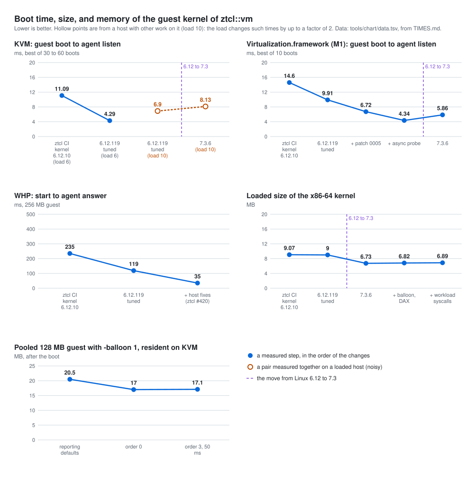

# ztcl-guest-kernel

This repository builds the Linux kernel of the guests of [ztcl::vm](https://github.com/beetlebugorg/ztcl): the small VMs that ztcl starts on KVM (Linux), Apple Virtualization.framework (macOS), and the Windows Hypervisor Platform (WHP). The kernel is Linux 7.3.6, the newest stable release, with a config and six patches for a fast boot and for the use cases of ztcl and dockyard.

<picture>
  <source media="(prefers-color-scheme: dark)" srcset="docs/progress-dark.svg">
  <source media="(prefers-color-scheme: light)" srcset="docs/progress-light.svg">
  
</picture>

`tools/chart/chart.py` makes the two charts from `tools/chart/data.tsv`, with the standard library of Python only. Each point comes from [TIMES.md](TIMES.md). A hollow point is from a host with other work on it (load average 10). On such a host the times change by up to a factor of 2, so compare a hollow point only with the hollow point next to it.

## Why a separate repository

Linux is GPL-2.0, and the patches here are GPL-2.0 too. ztcl, ztk, and dockyard are permissive and clean-room: their code comes from specifications and documentation, never from GPL source. This repository is the wall between the two. One agent reads and patches the kernel source here, and works in no other repository. The ztcl repositories use only what comes out of this one:

- the built kernels (CI artifacts, by URL and SHA-256);
- the config fragments (a config is not kernel source);
- the measured times;
- the descriptions of host-side protocols by effect and wire format, as [docs/vmgenid.md](docs/vmgenid.md).

## Build

Run `./build.sh` on Linux. `ARCH=arm64` builds the arm64 kernel, and `LLVM=1` builds it with clang and ld.lld on an x86-64 host. The output goes to `out/ARCH/`: `bzImage` and `vmlinux` on x86-64, `Image` on arm64, with `System.map`, `kernel.config`, and `SHA256SUMS`.

`build.sh` downloads the release archive from kernel.org and checks its SHA-256, applies `patches/*.patch`, and merges the fragments of `config/` onto `tinyconfig`. A patch that does not apply stops the build with the name of the patch. The build sets `SOURCE_DATE_EPOCH`, the build user, and the build host, so two builds with the same compiler give the same bytes. GCC 16.2.1 and GCC 13 (the Ubuntu 24.04 runners of CI) both build it.

### The config fragments

| Fragment | What it turns on or off |
|---|---|
| `10-base` | The base of ztcl (`tools/vm-guest/kernel.fragment`): 1000 Hz, initramfs, proc, sysfs, devtmpfs, tmpfs, virtio on PCI and MMIO, the console, vsock, block, rng, virtio-fs. |
| `20-x86_64` | The x86-64 base of ztcl: KVM guest, the MP table with no ACPI, virtio-mmio from the command line, the 8250 console, LZ4, 9p, dm-verity with `dm-mod.create`, and squashfs for the signed root. |
| `30-boot` | No legacy PTYs, and no VT, input, or i8042. IPv4 with loopback, virtio-net, and packet sockets, with no Ethernet or WLAN menus and no PTP clocks. Squashfs with LZ4, xz, and 4 KiB blocks. `ttynull`. virtio-balloon with free page reporting, and the DAX window of virtio-fs. |
| `40-x86_64-boot` | One UART, and the built-in command line: `percpu_alloc=page console=ttynull tsc=reliable ioapic_clean page_reporting.page_reporting_order=3 page_reporting.page_reporting_delay_ms=50`. The command line of the VMM comes after it. |
| `40-arm64-boot` | No options yet. arm64 has no built-in command line that goes before the one of the VMM. |
| `50-workload` | The system calls of common programs (node, git, toolchains, Claude Code, sandboxes): madvise, membarrier, rseq, SysV IPC, POSIX message queues, seccomp filters, AIO, process_vm_readv, userfaultfd, THP in madvise mode, fhandle, inotify, fanotify, kcmp, namespaces, high resolution timers with no idle tick, and vmgenid. |

### The patches

| Patch | What and why |
|---|---|
| 0001 | virtio_console: kick once for each fill of a receive queue, and fill at most 32 buffers. A kick is an exit to the VMM, and the fill made 256 of them. |
| 0002 | x86/intel: keep fast strings in a guest. The VMM gives the fast string bit of IA32_MISC_ENABLE as 0, and the kernel then used slower copies. |
| 0003 | x86/ioapic: the boot option `ioapic_clean` skips the scan and clear of the 24 pins of an I/O APIC that the VMM gives in its reset state. |
| 0004 | x86/mm: free the gaps of the kernel image with no poison. The poison was the first write to those pages, and each first write is a fault in the host. |
| 0005 | virtio_pci: poll the reset of a device every 10 to 20 us before `msleep(1)`, which sleeps 2 ms at 1000 Hz. |
| 0006 | vmgenid: take the device from the command line (`vmgenid.device=`). A new generation ID after a restore or a clone reseeds the RNG, and on x86 KVM steps the wall clock to the time of the host. |

The header of each patch has its measured gain.

## Publish and update

The workflow Build (`.github/workflows/build.yml`) builds both architectures on each push to main. Its artifacts are `guest-kernel-x86_64` and `guest-kernel-arm64`, each with `SHA256SUMS`. The repository makes no releases or tags.

The workflow Update (`.github/workflows/update.yml`) checks kernel.org each day. For a new stable release it builds both architectures, runs the boot test of ztcl on KVM (`test-kvm.sh`), times the boot against the current kernel (`tools/bench.sh`), and opens a PR with the results and a summary of the changelog. [UPDATING.md](UPDATING.md) has the policy:

- The kernel follows the newest stable release. It does not follow mainline or the release candidates.
- A point release merges within a few days, when the test passes and the times hold.
- A new series also gets a review of the config and the times of Virtualization.framework and WHP.
- A patch that does not apply is ported and measured again, or dropped when upstream has the same fix.

## The optimizations and their effect

All times are in ms. "Listen" is the boot clock of the guest when the agent listens on vsock. "Answer" is `ztcl::vm start` to the first bytes of the agent, on the host. The guest has 1 CPU, and the root is the signed image of ztcl: squashfs on dm-verity. The KVM host is an Intel Skylake at 4 GHz with 8 cores, with other builds on it. Each comparison ran round robin in one process, so both kernels saw the same load. [TIMES.md](TIMES.md) has each table. All dates are 2026-11-27.

### Boot to the agent

| Host | Before | After |
|---|---|---|
| KVM, 64 MB, load 6, best of 40: the ztcl CI kernel 6.12.10 against 6.12.119 with these changes | listen 11.09, answer 21.85 | listen 4.29, answer 13.58 |
| KVM, `test-kvm.sh` of ztcl with an initramfs, best of 10 | guest boot to agent 11.6, start to answer 24.8 (the numbers of ztcl before this work) | 4.33 and 16.86 (load 4) |
| Virtualization.framework, M1, 128 MB, listen, best of 10 | 14.60 (the CI kernel) | 9.91 (6.12.119), 6.72 (with patch 0005), 4.34 (with `driver_async_probe=virtio-pci`) |
| WHP, 256 MB, start to answer | 235 (the CI kernel) | 119 (this kernel), 35 (with the host changes of ztcl #420) |

### The gain of each change, on KVM

| Change | Measured where | Before | After |
|---|---|---|---|
| No legacy PTYs | `pty_init` | 2.66 | 0.52 |
| No serio (no i8042 probe) | `i8042_init` | 1.04 | 0 |
| Patch 0001 | the probe of the console | 3.1 to 3.5 | 0.4 to 0.6 |
| Patch 0002 | the start of init, mean of 8 | 5.84 | 5.40 |
| Patch 0003 | `enable_IO_APIC` | 0.96 | under 0.01 |
| Patch 0004 | the mount of the root to init, mean of 8 | 1.02 to 1.83 | 0.24 to 0.27 |
| Patch 0005 (on VZ) | `virtio_pci_driver_init` | 6.16 | 3.10 |
| `percpu_alloc=page` | listen, best of 30 | 16.62 | 13.12 |
| `console=ttynull` (no warnings on the 8250) | listen, p25 of 30 | 15.74 | 13.52 |

### Linux 7.3.6 against 6.12.119

The kernel moved to 7.3.6 to follow the newest stable release. On Virtualization.framework, 7.3.6 boots in 5.86 ms against 4.34 ms (best of 10): about 1.5 ms more, in the early setup, the initcalls, and user space. On KVM at load 10 the pair is 8.13 against 6.90. 7.3 has only full or lazy preemption on x86-64 and arm64, and arm64 forces jump labels and virtually mapped stacks. A build with no preemption gave no measured gain. The loaded x86-64 kernel is smaller: 6.73 MB against 9.00 MB. The branch `linux-6.12` keeps 6.12.119 for comparison.

### Size and memory

| Change | Effect |
|---|---|
| virtio-net and packet sockets | about 16 us of the boot, with no measured change on VZ |
| virtio-balloon and the DAX window of virtio-fs | about 50 us of the boot, 90 KB of the loaded kernel |
| `50-workload` (the system calls) | 0.13 to 0.22 ms of the boot (0.11 ms is `hugepage_init`), 63 KB |
| madvise | node runs with its JIT. With no madvise, V8 stops with "Check failed: 0 == ret". |
| squashfs xz | no measured cost: only the mount of an xz disk uses it |
| Free page reporting at boot (order 3, 50 ms) | a pooled 128 MB guest on KVM: 17.1 MB resident, against 20.5 MB with the defaults |
| vmgenid (patch 0006) | no cost with no `vmgenid.device=` |

## More

- [TIMES.md](TIMES.md): each measurement, with its host, load, and count of boots.
- [UPDATING.md](UPDATING.md): the update policy.
- [PROPOSAL.md](PROPOSAL.md): the guest features for the use cases of ztcl::vm, ranked by gain and cost.
- [docs/vmgenid.md](docs/vmgenid.md): the host side of the generation ID device.
- `tools/bench.sh`: the boot times of kernels on KVM, round robin.
